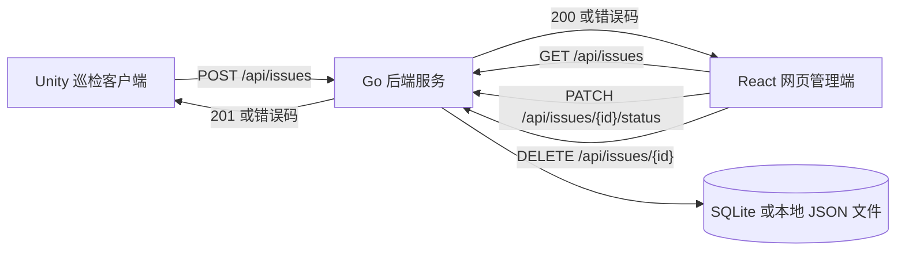
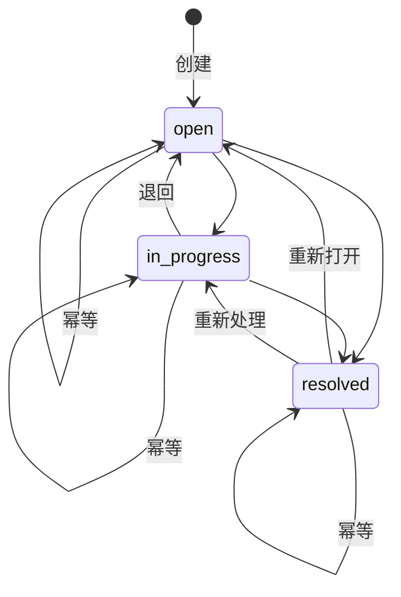

# Unity-3D巡检 需求规格说明书

## 1 文档信息

| 项目 | 内容 |
| --- | --- |
| 文档名称 | Unity-3D巡检 需求规格说明书 |
| 版本 | v1.0 |
| 编写日期 | 2026-10-30 |
| 文档状态 | 评审稿 |
| 适用系统 | Unity 巡检客户端、React 网页管理端、Go 后端服务 |

本文件是巡检客户端、网页管理端与后端服务三端实现与验收的唯一依据。当口头描述与本文件冲突时，以本文件第 4、5、6 章为准。

## 2 引言

### 2.1 编写目的

把「在三维虚拟现场中发现设备异常或安全隐患、记录位置并上报，管理人员在网页中查看并处置」这一业务流程，固化为可判定的功能条目、固定的接口契约和统一的字段定义，使三端可以并行实现而不产生字段名、枚举取值或错误处理上的分歧。

### 2.2 项目背景

园区、厂房或机房的巡检人员发现设备异常、安全隐患等问题时，需要记录问题所在位置并上报。管理人员随后在电脑网页中查看这些问题，并更新其处理状态。

系统由三部分组成：

- **巡检客户端**：基于 Unity LTS 与 C#，提供虚拟场景、射线点击、空间标记与问题上报能力。
- **网页管理端**：基于 React 与 TypeScript，提供问题查看与状态修改能力。
- **后端服务**：基于 Go，提供数据接口并负责持久化。

后端框架不限，持久化只能使用 SQLite 或本地 JSON 文件，不引入独立数据库服务。

### 2.3 术语与缩写

| 术语 | 含义 |
| --- | --- |
| 巡检现场 | 客户端中用 Unity 基础几何对象搭建的三维虚拟场景，包含地面、墙面、机柜/设备/管线等物体 |
| 问题（Issue） | 一次上报的记录，是被保存、被查询、被修改状态的唯一业务对象 |
| 标记（Marker） | 放置在场景中射线命中位置上的可见对象，用于指示问题所在的三维位置 |
| 待提交标记 | 已放置、但对应问题尚未提交成功的标记；同一时刻最多存在一个 |
| 优先级 | 问题的紧急程度，取值 `low`、`medium`、`high` |
| 状态 | 问题的处理阶段，取值 `open`、`in_progress`、`resolved` |
| 命中点 | 射线与场景物体碰撞体相交处的世界坐标点 |

### 2.4 参考资料

| 文件 | 说明 |
| --- | --- |
| `项目介绍.txt` | 项目背景与固定技术栈的来源 |
| `CODEBUDDY.md` | 仓库既有约定：问题实体是唯一跨端契约，坐标视为不透明数据，状态机归属后端 |

## 3 系统总览

### 3.1 系统组成

三端共用**一个后端服务实例**与**一份持久化数据**。客户端与管理端之间没有任何直接通信，二者的全部数据交换都经由后端完成。



### 3.2 角色与职责

| 角色 | 使用端 | 职责 |
| --- | --- | --- |
| 巡检人员 | Unity 客户端 | 在虚拟现场中移动查看，点击设备表面标记问题位置，填写并上报问题 |
| 管理人员 | React 网页管理端 | 查看问题列表，将问题状态更新为处理中或已解决 |

系统不区分账号，不校验身份；角色仅用于划分使用场景与端职责。

### 3.3 端到端主流程

1. 巡检人员在客户端场景中移动并转动视角，查看需要检查的设备。
2. 巡检人员点击设备或场景表面，客户端在射线命中位置放置一个待提交标记。
3. 客户端弹出问题表单，自动带出该标记的 `x/y/z` 坐标；巡检人员填写标题、可选描述并选择优先级。
4. 巡检人员提交，客户端将问题发送至后端；后端生成唯一标识、置初始状态为 `open` 并持久化，返回保存结果。
5. 客户端根据返回结果显示提交成功或失败提示；成功后移除该标记并关闭表单。
6. 管理人员打开管理端，管理端从后端拉取问题列表并展示。
7. 管理人员选择一个问题，将其状态改为 `in_progress` 或 `resolved`（问题复现时可改回 `open`），后端校验后更新并持久化。

### 3.4 端到端数据流

| 环节 | 数据方向 | 内容 |
| --- | --- | --- |
| 上报 | 客户端 → 后端 | 标题、描述、优先级、标记坐标 |
| 补充 | 后端内部 | 唯一标识、状态 `open`、创建时间、更新时间 |
| 查询 | 管理端 → 后端 | 无入参，返回全部已保存问题 |
| 处置 | 管理端 → 后端 | 问题标识 + 目标状态 |

### 3.5 运行环境与统一约束

- **客户端**：Unity LTS，目标平台为可交互的桌面运行环境，需同时具备相机的移动与旋转输入。
- **管理端**：React + TypeScript，运行于桌面浏览器，通过与后端同机或同局域网的地址访问服务。
- **后端**：Go，单一可执行服务，默认监听 `8080` 端口，对外提供 `/api` 前缀的 HTTP 接口。
- **数据唯一性**：客户端上报与管理端查询读写的是同一份数据，不存在第二处存储或中间缓存。
- **持久化**：问题数据写入磁盘（SQLite 数据库文件或本地 JSON 文件），服务进程重启后已保存的问题仍可被读取。
- **跨域**：后端须允许浏览器页面直接访问，管理端不需要通过额外代理才能取到数据。
- **坐标语义**：`location` 中的 `x/y/z` 为客户端场景的世界坐标，后端与管理端只存储与透传，不做单位换算或轴向变换。

## 4 功能需求

### 4.1 巡检客户端

#### 4.1.1 虚拟巡检现场构成

- 现场使用 Unity 内置基础几何对象搭建，不依赖外部美术资源或第三方场景包。
- 现场至少包含下列两类环境物体：一块覆盖相机活动区域的地面、至少一面竖直墙面。
- 现场至少包含两个可被巡检的设备类物体，可选取机柜、设备箱体或管线中的任意组合，例如两台并排的机柜。
- 场景中可被射线命中的对象不少于两个，且各对象的碰撞体相互独立，因此点击不同对象得到的命中点坐标不同。
- 每个需要被点击的对象都挂载碰撞体；纯装饰性质的物体可以不挂碰撞体，也不必可点击。
- 各设备对象的尺寸、位置在场景中互不重叠，巡检人员从初始位置可观察到全部可点击对象中的至少两个。

#### 4.1.2 视角移动与转向

- 客户端支持相机在场景中平移，输入为键盘方向键或 `W/A/S/D`，可移动到地面范围内的不同位置。
- 客户端支持相机转动视角，输入为鼠标移动或按住鼠标右键拖动，水平方向可连续旋转一周。
- 垂直方向的俯仰角度受上下限约束（-80° 至 80°），相机不会翻转至倒置状态。
- 相机的活动范围限制在地面覆盖的区域内，不会移动到场景之外或穿透地面。

#### 4.1.3 射线点击检测

- 在场景区域按下鼠标左键时，以相机为起点、以屏幕光标位置对应的方向发射射线。
- 射线检测使用 `Physics.Raycast`，只有命中挂载碰撞体的物体时才判定为一次有效点击。
- 射线未命中任何物体时，不放置标记、不打开表单、不产生任何界面变化。
- 命中点坐标取自射线的碰撞交点，而非物体中心或网格顶点。

#### 4.1.4 问题标记的放置

- 一次有效点击后，在射线命中点处生成一个可见的标记对象，其世界坐标与该命中点完全一致。
- 标记在视觉上可与场景物体区分，例如使用亮色球体或带颜色的柱状体，尺寸不遮挡整个被点击对象。
- 标记对象不挂载碰撞体，因此不会被射线优先命中；点击标记所在区域等同于点击其下方的场景表面。
- 标记的坐标同时写入问题表单的只读坐标区域，格式为 `x`、`y`、`z` 三个数值。

#### 4.1.5 问题表单与字段约束

- 有效点击后显示问题表单，表单包含标题输入框、描述输入框、优先级选择控件、只读坐标展示区，以及提交与取消两个按钮。
- 标题为必填项：去除首尾空白后长度须大于等于 1；为空时点击提交应被拦截，并显示包含「标题不能为空」字样的提示。
- 描述为可选项：允许为空或不填写，为空时按空字符串上报。
- 优先级为必选项，取值为 `low`、`medium`、`high` 三者之一，表单默认选中 `medium`。
- 坐标为只读项，取值为当前待提交标记的世界坐标，不提供手工编辑入口。
- 提交请求发出后至响应返回前，提交按钮处于不可再次触发的状态，避免同一问题被重复创建。

#### 4.1.6 提交结果提示

- 提交时按第 5 章约定调用创建问题接口，请求体包含标题、描述、优先级、坐标，以及自动判定的设备编号与固定区域名（见 6.4）。
- 后端返回成功（HTTP 201）时，界面显示包含「提交成功」字样的提示，随后移除待提交标记、清空表单内容并关闭表单。
- 后端返回非 2xx、或出现网络错误、超时时，界面显示包含「提交失败」字样的提示，并保留待提交标记与已填写内容，允许巡检人员再次提交。
- 成功与失败使用不同的提示文案，提示文本显示在界面固定区域，在提交结果返回后立即可见。

#### 4.1.7 界面操作与场景点击的隔离

- 当鼠标指针位于任何界面元素之上时（包括按钮、输入框、下拉选择控件、提示文本的交互区域），点击不得触发射线检测，不得放置标记。
- 判定方式：在响应点击前检查指针是否位于界面元素之上（如 `EventSystem.current.IsPointerOverGameObject()` 返回真），是则直接返回。
- 在输入框中输入文字、点击提交或取消按钮、展开并选择优先级等操作，均不产生新的标记。
- 拖动视角的操作（按住右键拖动）不产生标记。

#### 4.1.8 待提交标记的生命周期

- 场景中同一时刻最多存在一个待提交标记。
- 当已存在待提交标记时再次发生有效点击，客户端移除旧标记并在新命中点创建标记，标记总数保持为一，表单中的坐标同步更新为新位置。
- 点击取消按钮或关闭表单时，移除未保存的标记，且不向后端发送任何请求。
- 提交成功后移除该标记；提交失败时保留该标记，直至用户取消或再次提交成功。
- 标记仅表示尚未落库的问题位置，已保存的问题不在场景中生成标记。

### 4.2 网页管理端

#### 4.2.1 问题列表获取

- 页面加载时向后端请求问题列表接口，取得当前已保存的全部问题。
- 列表按创建时间倒序排列，最新上报的问题显示在最前；排序由后端结果决定，管理端不自行重排。
- 页面提供刷新操作，重新拉取列表，用于查看其他巡检人员新上报的问题。
- 列表为空（后端正常响应但无数据）时，显示包含「暂无问题」字样的空状态提示，而非错误提示。

#### 4.2.2 列表字段展示

- 每条问题至少展示：标题、优先级、状态三项。
- 优先级显示为 `low`、`medium`、`high` 或其固定对应的中文标签（低/中/高），同一取值在全表中使用同一文案。
- 状态显示为 `open`、`in_progress`、`resolved` 或其固定对应的中文标签（待处理/处理中/已解决），同一取值在全表中使用同一文案；列表中的状态只读，修改入口见 4.2.3。
- 每条问题同时展示其坐标，便于管理人员定位现场位置。
- 上报携带设备编号与区域时，列表与详情中一并展示；未携带时显示「未标注设备」「未标注区域」等占位文案。
- 表格或卡片中不出现空白单元格：缺失的可选字段（如描述为空）显示占位文案而非留空。

#### 4.2.3 状态修改

- 状态修改只提供一个入口：问题详情抽屉中的三态选择控件。列表中的状态列仅作只读展示，不提供第二个修改入口。
- 控件可选目标值为 `open`、`in_progress`、`resolved`，当前状态高亮显示。
- 选择目标值后，管理端按第 5 章约定调用修改状态接口，请求体仅包含目标状态。
- 请求成功（HTTP 200）后，该条问题显示的状态以后端返回的值为准，并同步刷新其更新时间。
- 请求失败时，该条问题的状态回退为修改前的值，并显示包含「状态修改失败」字样的提示。
- 状态修改过程中，同一行的状态控件不可重复提交。

#### 4.2.4 后端不可用时的错误提示

- 列表请求失败时（网络错误、连接被拒绝、超时、HTTP 5xx），页面显示包含「加载失败」字样的错误提示，并给出重试操作。
- 该情形下页面框架、标题与错误提示正常渲染，不得出现只显示空白页或白屏的情况。
- 处于错误状态时不渲染「暂无问题」空状态，避免把服务异常误报为数据为空。
- 后端恢复后，通过重试或刷新操作可重新加载列表，无需手动刷新整个浏览器页面。
- 单条问题的状态修改失败不影响列表其余内容的展示。

#### 4.2.5 筛选、详情与删除

- 列表支持按状态、优先级、区域筛选，并支持对标题、描述、设备编号、区域做文本检索；筛选只改变展示集合，不改变后端返回的先后顺序。
- 区域分布按 5 个固定区域（见 6.4）呈现，无上报的区域计数为 0；框外记录归入「厂区其他」，不隐藏。
- 每条问题可展开详情，展示完整描述、设备编号、区域、坐标以及上报与更新时间。
- 管理端提供删除操作，调用删除接口；执行前必须二次确认，并在确认文案中说明不可撤销。
- 删除成功后，该条记录立即从列表与统计中移除；删除失败时保留原有数据并提示失败原因。

### 4.3 后端服务

#### 4.3.1 服务运行状态检查

- 后端提供状态检查接口，服务正常运行时对请求返回 HTTP 200 与固定响应体 `{"status":"ok"}`。
- 该接口不读写业务数据，不依赖存储状态，可被运维或客户端用于判断服务是否可达。
- 服务未启动或端口不可达时，请求方应得到连接失败的结果，后端不返回伪造的成功响应。

#### 4.3.2 接收并保存上报的问题

- 后端接收客户端提交的问题，校验通过后写入存储，并返回 HTTP 201 与保存后的完整问题对象（含服务端生成的标识、状态与时间字段）。
- 保存成功的问题立即可被问题列表接口查询到，无需重启服务。
- 写入失败（磁盘不可写等）时返回 HTTP 500 与 `INTERNAL` 错误码，不返回成功状态，避免客户端误报提交成功。

#### 4.3.3 返回已保存的问题列表

- 后端提供问题列表接口，返回当前已保存的全部问题对象数组，数组元素字段完整（不少于第 6 章定义的字段）。
- 列表按创建时间倒序返回，最新的问题在前。
- 无数据时返回 HTTP 200 与空数组 `[]`，不视为错误。
- 同一份数据在服务重启前后返回一致：标识、状态、坐标、时间字段均不得变化。

#### 4.3.4 按问题标识修改处理状态

- 后端提供按标识修改状态的接口，路径中携带问题标识，请求体仅携带目标状态。
- 校验通过后，更新该问题的 `status` 与 `updatedAt`，其余字段保持不变，并返回 HTTP 200 与更新后的完整问题对象。
- 标识不存在时返回 HTTP 404 与 `ISSUE_NOT_FOUND` 错误码，且不创建新问题。
- 修改结果持久化，下一次列表查询返回的是更新后的状态。

#### 4.3.5 唯一标识与默认状态

- 新问题的标识由服务端生成，不与已有标识重复；采用 UUID v4 或等价的随机唯一方案。
- 创建时状态固定为 `open`，不接受客户端指定的状态值；客户端即使在请求体中携带 `status`、`id`、`createdAt`，也一律忽略。
- 创建时同时写入 `createdAt` 与 `updatedAt`，两者取服务端当前时间，格式为 RFC3339。

#### 4.3.6 参数校验与明确错误响应

- 标题缺失、非字符串，或去除首尾空白后为空时，返回 HTTP 400 与 `INVALID_TITLE`，`field` 为 `title`。
- 优先级不在 `low`、`medium`、`high` 之中（包括缺失）时，返回 HTTP 400 与 `INVALID_PRIORITY`，`field` 为 `priority`。
- 目标状态不在 `open`、`in_progress`、`resolved` 之中时，返回 HTTP 400 与 `INVALID_STATUS`，`field` 为 `status`。
- 坐标缺失、`x/y/z` 任一非数值或为 NaN、正负无穷时，返回 HTTP 400 与 `INVALID_LOCATION`，`field` 为 `location`。
- 请求体不是合法 JSON 或字段类型不符时，返回 HTTP 400 与 `INVALID_JSON`。
- 所有错误响应遵循第 5 章统一结构，`message` 需指出具体原因（例如「标题不能为空」「priority 必须为 low、medium 或 high 之一」），不使用无信息的通用文案。
- 校验失败时不写入任何数据，已存数据不受影响。

#### 4.3.7 数据在服务重启后仍然存在

- 持久化只能使用 SQLite 数据库文件或本地 JSON 文件，不使用外部数据库服务或内存存储。
- 启动时从持久化文件加载已有数据；文件中不存在数据时以空集合启动。
- 服务重启后，问题列表接口返回的问题数量、标识、状态、坐标与时间字段与重启前一致。
- 持久化路径相对服务可执行文件或工作目录固定，不因启动方式不同而切换存储文件。

#### 4.3.8 客户端与管理端共用同一后端与同一份数据

- 客户端与管理端访问同一个服务实例，读写同一份存储；不存在按端隔离的数据副本。
- 客户端上报成功后，管理端刷新列表即可看到该问题；管理端修改状态后，客户端重新提交的新问题同样进入该列表。
- 多个请求并发创建问题时，每个问题各自获得唯一标识并全部持久化，不出现互相覆盖或丢失。

#### 4.3.9 浏览器可正常访问后端

- 后端启用跨域资源共享，允许管理端页面所在来源的跨域请求，允许方法至少包含 `GET`、`POST`、`PATCH`，允许请求头包含 `Content-Type`。
- 浏览器的预检请求（`OPTIONS`）返回 2xx 状态，管理端无需额外的反向代理或中转服务即可直接调用接口。
- 跨域配置不因来源端口变化而失效（本地开发环境使用不同端口访问时仍可正常通信）。

## 5 接口契约

### 5.1 通用约定

| 约定项 | 内容 |
| --- | --- |
| 基址 | `http://localhost:8080`，端口可由服务端配置修改 |
| 路径前缀 | 全部业务接口以 `/api` 开头 |
| 请求/响应格式 | `application/json`，字符集 UTF-8 |
| 时间格式 | RFC3339 字符串，UTC 时区，如 `2026-10-30T08:12:33Z` |
| 标识 | 不透明字符串，调用方不得解析其内部结构 |
| 未知字段 | 请求体中的未定义字段一律忽略、不报错；客户端自带的服务端字段（`id`、`status`、`createdAt`、`updatedAt`）同样忽略，以服务端生成的值为准 |
| 错误结构 | 统一为 `{"error":{"code","message","field"}}` 对象 |

### 5.2 端点总览

| 方法 | 路径 | 用途 | 成功响应 | 主要失败 |
| --- | --- | --- | --- | --- |
| GET | `/api/health` | 服务运行状态检查 | 200 `{"status":"ok"}` | 500 |
| POST | `/api/issues` | 接收并保存上报的问题 | 201，完整问题对象 | 400 |
| GET | `/api/issues` | 返回已保存的问题列表 | 200，问题对象数组 | 500 |
| PATCH | `/api/issues/{id}/status` | 按标识修改处理状态 | 200，更新后的完整问题对象 | 400 / 404 |
| DELETE | `/api/issues/{id}` | 按标识删除问题记录 | 204，无响应体 | 404 |

### 5.3 服务运行状态检查

`GET /api/health`

请求：无参数、无请求体。

响应 200：

```json
{
  "status": "ok"
}
```

### 5.4 创建问题

`POST /api/issues`

请求体字段：

| 字段 | 类型 | 必填 | 约束 |
| --- | --- | --- | --- |
| title | string | 是 | 去除首尾空白后长度 ≥ 1 |
| description | string | 否 | 缺省按空字符串处理 |
| priority | string | 是 | `low` / `medium` / `high` |
| deviceId | string | 否 | 设备编号或名称，去除首尾空白后超过 64 字符截断 |
| area | string | 否 | 5 个固定区域名之一（见 6.4），由客户端按命中点判定；框外留空 |
| location | object | 是 | 含 `x`、`y`、`z` 三个有限数值 |

请求示例：

```json
{
  "title": "机柜A顶部渗水",
  "description": "柜顶有明显水渍，附近线缆受潮",
  "priority": "high",
  "deviceId": "CB-101",
  "area": "配电区",
  "location": { "x": 3.42, "y": 1.05, "z": -6.18 }
}
```

响应 201（字段含义见第 6 章）：

```json
{
  "id": "8f1c2d3e-4a5b-4c6d-8e9f-0a1b2c3d4e5f",
  "title": "机柜A顶部渗水",
  "description": "柜顶有明显水渍，附近线缆受潮",
  "priority": "high",
  "status": "open",
  "location": { "x": 3.42, "y": 1.05, "z": -6.18 },
  "createdAt": "2026-10-30T08:12:33Z",
  "updatedAt": "2026-10-30T08:12:33Z"
}
```

响应 400 示例（标题为空）：

```json
{
  "error": {
    "code": "INVALID_TITLE",
    "message": "标题不能为空",
    "field": "title"
  }
}
```

响应 400 示例（优先级非法）：

```json
{
  "error": {
    "code": "INVALID_PRIORITY",
    "message": "priority 必须为 low、medium 或 high 之一",
    "field": "priority"
  }
}
```

### 5.5 查询问题列表

`GET /api/issues`

请求：无参数、无请求体。

响应 200（数组，按 `createdAt` 倒序；无数据时为空数组）：

```json
[
  {
    "id": "8f1c2d3e-4a5b-4c6d-8e9f-0a1b2c3d4e5f",
    "title": "机柜A顶部渗水",
    "description": "柜顶有明显水渍，附近线缆受潮",
    "priority": "high",
    "status": "in_progress",
    "location": { "x": 3.42, "y": 1.05, "z": -6.18 },
    "createdAt": "2026-10-30T08:12:33Z",
    "updatedAt": "2026-10-30T09:40:07Z"
  },
  {
    "id": "1a2b3c4d-5e6f-4a7b-8c9d-0e1f2a3b4c5d",
    "title": "走廊照明灯闪烁",
    "description": "",
    "priority": "low",
    "status": "open",
    "location": { "x": -2.10, "y": 2.80, "z": 4.55 },
    "createdAt": "2026-10-29T14:03:10Z",
    "updatedAt": "2026-10-29T14:03:10Z"
  }
]
```

### 5.6 修改处理状态

`PATCH /api/issues/{id}/status`

路径参数：`id` 为问题标识，取自问题对象。

请求体字段：

| 字段 | 类型 | 必填 | 约束 |
| --- | --- | --- | --- |
| status | string | 是 | `open` / `in_progress` / `resolved` |

请求示例：

```json
{
  "status": "resolved"
}
```

响应 200：

```json
{
  "id": "8f1c2d3e-4a5b-4c6d-8e9f-0a1b2c3d4e5f",
  "title": "机柜A顶部渗水",
  "description": "柜顶有明显水渍，附近线缆受潮",
  "priority": "high",
  "status": "resolved",
  "location": { "x": 3.42, "y": 1.05, "z": -6.18 },
  "createdAt": "2026-10-30T08:12:33Z",
  "updatedAt": "2026-10-30T10:02:51Z"
}
```

响应 400 示例（状态非法）：

```json
{
  "error": {
    "code": "INVALID_STATUS",
    "message": "status 必须为 open、in_progress 或 resolved 之一",
    "field": "status"
  }
}
```

响应 404 示例（标识不存在）：

```json
{
  "error": {
    "code": "ISSUE_NOT_FOUND",
    "message": "指定标识的问题不存在",
    "field": ""
  }
}
```

### 5.7 删除问题

`DELETE /api/issues/{id}`

路径参数：`id` 为问题标识，取自问题对象。

请求：无请求体。

响应 204：无响应体，问题从持久化存储中移除。

响应 404 示例（标识不存在，与改状态接口一致）：

```json
{
  "error": {
    "code": "ISSUE_NOT_FOUND",
    "message": "指定标识的问题不存在",
    "field": ""
  }
}
```

删除是不可逆操作，调用方应自行完成二次确认；客户端中已还原的标记在下一次拉取列表后不再出现。

### 5.8 错误码表

| 错误码 | HTTP 状态 | 触发条件 | `field` |
| --- | --- | --- | --- |
| `INVALID_JSON` | 400 | 请求体不是合法 JSON，或字段类型与约定不符 | 出错字段名，无法定位时为空字符串 |
| `INVALID_TITLE` | 400 | 标题缺失、非字符串或去除首尾空白后为空 | `title` |
| `INVALID_PRIORITY` | 400 | 优先级缺失或不在三档之内 | `priority` |
| `INVALID_STATUS` | 400 | 目标状态缺失或不在三态之内 | `status` |
| `INVALID_LOCATION` | 400 | 坐标缺失、分量非数值、为 NaN 或无穷 | `location` |
| `ISSUE_NOT_FOUND` | 404 | 路径中的问题标识不存在 | 空字符串 |
| `INTERNAL` | 500 | 存储写入失败、读取异常等非预期错误 | 空字符串 |

校验顺序为：JSON 可解析性 → 标题 → 优先级 → 坐标 → 状态（仅改状态接口）。同一请求存在多处错误时，返回首个命中的错误码。

### 5.9 跨域要求

| 配置项 | 要求 |
| --- | --- |
| 允许来源 | 管理端页面来源；本地开发环境允许 `http://localhost` 与 `http://127.0.0.1` 的任意端口 |
| 允许方法 | `GET`、`POST`、`PATCH`、`DELETE`、`OPTIONS` |
| 允许请求头 | `Content-Type` |
| 预检响应 | `OPTIONS` 请求返回 2xx，并携带相应的跨域响应头 |
| 凭据 | 不使用 Cookie 或鉴权头，无需开启凭据模式 |

## 6 数据模型与状态机

### 6.1 问题实体字段

| 字段 | 类型 | 必填 | 约束 | 说明 |
| --- | --- | --- | --- | --- |
| `id` | string | 由服务端生成 | 全局唯一，非空 | 服务端生成的唯一标识，创建后不可变更 |
| `title` | string | 是 | 去除首尾空白后长度 ≥ 1 | 问题标题，客户端表单必填项 |
| `description` | string | 否 | 缺省为空字符串 | 问题描述，可为空 |
| `priority` | string | 是 | `low` / `medium` / `high` | 优先级，客户端必选，默认 `medium` |
| `status` | string | 由服务端生成 | `open` / `in_progress` / `resolved` | 处理状态，创建时固定为 `open` |
| `deviceId` | string | 否 | 缺省为空字符串，最长 64 字符 | 设备编号或设备名称，供管理端筛选与分组 |
| `area` | string | 否 | 缺省为空字符串，最长 64 字符 | 固定区域名（见 6.4）；为空时管理端按坐标补判，仍不命中则归入「厂区其他」 |
| `location.x` | number | 是 | 有限数值，非 NaN、非正负无穷 | 命中点世界坐标 X |
| `location.y` | number | 是 | 有限数值，非 NaN、非正负无穷 | 命中点世界坐标 Y |
| `location.z` | number | 是 | 有限数值，非 NaN、非正负无穷 | 命中点世界坐标 Z |
| `createdAt` | string | 由服务端生成 | RFC3339，UTC | 创建时间，创建后不可变更 |
| `updatedAt` | string | 由服务端生成 | RFC3339，UTC，不早于 `createdAt` | 最后修改时间，状态变更时刷新 |

字段约定：

- `location` 为嵌套对象，三个分量均为 JSON number，不使用字符串或数组形式。
- `location` 的分量表示客户端场景的世界坐标，服务端与管理端只做存储与透传，不进行单位换算、轴向翻转，也不对数值取整或归一化。
- 客户端上报时不得携带 `id`、`status`、`createdAt`、`updatedAt`；如携带，服务端忽略并以自身生成的值为准。
- `deviceId` 与 `area` 是可选描述字段：缺失或为空白字符串时统一存为空字符串，不得因此拒绝上报。
- `area` 的取值是固定的 5 个区域名之一，由客户端根据命中点自动判定，管理端不提供手工改写入口。
- 除 `status` 与 `updatedAt` 外，其余字段在创建后不提供修改入口；删除走 `DELETE /api/issues/{id}`。

### 6.2 枚举取值

优先级：

| 取值 | 语义 |
| --- | --- |
| `low` | 低，可延后处理 |
| `medium` | 中，常规处理 |
| `high` | 高，需优先处理 |

状态：

| 取值 | 语义 |
| --- | --- |
| `open` | 待处理，问题的初始状态 |
| `in_progress` | 处理中，已有人跟进处置 |
| `resolved` | 已解决，处置完成 |

枚举值一律使用小写英文，服务端按完全匹配校验，`High`、`IN_PROGRESS`、空字符串等均属非法取值。

### 6.3 状态机



合法迁移一览：

| 当前状态 | → `open` | → `in_progress` | → `resolved` |
| --- | --- | --- | --- |
| `open` | 合法（无变化） | 合法 | 合法 |
| `in_progress` | 合法（退回） | 合法（无变化） | 合法 |
| `resolved` | 合法（重新打开） | 合法（重新处理） | 合法（无变化） |

规则说明：

- 九种迁移全部合法，包括目标状态与当前状态相同的幂等情形；服务端不要求状态按固定顺序推进。
- 唯一的强制校验是目标状态必须属于 `open`、`in_progress`、`resolved` 三者之一，非法取值返回 `INVALID_STATUS`（见 5.8）。
- 允许 `open` 直接转为 `resolved`：现场问题可能一次处置完毕，不强制经过「处理中」。
- 允许 `resolved` 回到 `open` 或 `in_progress`：已解决的问题可能复现或被误判，硬性单向流转会迫使使用者绕开系统。
- 状态变更只能通过修改状态接口发生；创建时状态固定为 `open`，不接受调用方指定。
- 每次状态变更（含幂等情形）都刷新 `updatedAt`，`createdAt` 与 `id` 始终不变。
- 状态机由服务端统一裁决，客户端与管理端只提交初始值或目标值，不在各自端内实现第二套规则。

### 6.4 固定区域

厂区按设备分布固定划分为 5 个区域，范围和名称不随上报内容变化。坐标系与 `location` 一致：X 向东增大，Z 向北增大，单位为场景米。

| 序号 | 区域名 | 覆盖设备 | X 范围 | Z 范围 |
| --- | --- | --- | --- | --- |
| 1 | 泵区 | P-101A / P-101B 泵组与出口集管 | -19.5 ~ -9.2 | -0.4 ~ 7.2 |
| 2 | 储罐区 | T-201 / T-202 储罐与罐间管线 | -6.4 ~ 8.4 | 5.0 ~ 12.8 |
| 3 | 输送区 | 输送带、端部滚筒与驱动电机 | 12.2 ~ 16.4 | -6.0 ~ 6.0 |
| 4 | 配电区 | 低压配电柜与电缆桥架 | -0.4 ~ 10.4 | -11.0 ~ -8.0 |
| 5 | 控制区 | 控制台、大屏与值班座椅 | 13.0 ~ 19.0 | -12.6 ~ -7.4 |

归属规则：

- 五个区域的矩形范围互不重叠，边界值计入区域。
- 客户端在上报时按命中点坐标判定区域并写入 `area`；命中点落在所有区域之外时写入空字符串。
- 管理端始终展示上述 5 个固定区域（无上报时计数为 0），并在存在框外记录时追加「厂区其他」分组。
- 对历史上 `area` 为空的记录，管理端按坐标落入的矩形补判区域，避免旧数据游离在区域统计之外。
- 区域划分属于场景信息：新增或调整区域时同步客户端、管理端常量与本表。

## 7 范围外事项与假设

### 7.1 范围外事项

下列内容不在本期范围内，实现时不应主动引入，也不应作为验收项：

| 事项 | 说明 |
| --- | --- |
| 登录与鉴权 | 不做账号、密码、令牌、会话，接口不校验调用方身份 |
| 用户体系与角色权限 | 不做巡检人员与管理人员的数据隔离，所有问题对全部使用方可见 |
| 图片与附件 | 不支持上传照片、视频或任意文件，问题只含文本与坐标 |
| 实时推送 | 不使用 WebSocket 或推送服务，管理端通过刷新或重新请求获取最新数据 |
| 管理端三维回显 | 管理端以文本形式展示坐标，不渲染场景或三维标记 |
| 多场景与场景切换 | 客户端只有一个巡检现场，不做场景选择与切换 |
| 问题删除与内容编辑 | 除状态外不提供修改或删除问题的接口 |
| 分页、搜索、筛选与排序自定义 | 列表一次返回全部数据，排序固定为创建时间倒序 |
| 离线与断网续传 | 客户端不做本地缓存与补传，提交失败由用户手动重试 |
| 多语言与移动端适配 | 界面使用简体中文，管理端面向桌面浏览器 |

### 7.2 假设与依赖

- 客户端与管理端运行在同一台机器或同一局域网内，能够直接访问后端服务地址，不存在网络隔离或防火墙拦截。
- 后端以单实例运行，不做多副本部署，因此唯一标识只需在单个进程的存储范围内不重复。
- 时间字段一律由服务端生成，不依赖客户端时钟，因此客户端时钟偏差不影响数据。
- Unity 客户端使用项目固定的 LTS 版本，场景对象使用内置基础几何体，不引入需额外下载的美术资源。
- 管理端面向支持 ES2020 与 `fetch` 的现代桌面浏览器，不考虑旧版浏览器兼容。
- 后端的持久化文件位于固定路径，运行期间该路径可读写，且不会被其他进程改写。
- 本文件描述的是功能与接口契约，不含具体的框架选型、目录结构与部署脚本；这些由实现阶段决定，但不得违反第 4、5、6 章。
